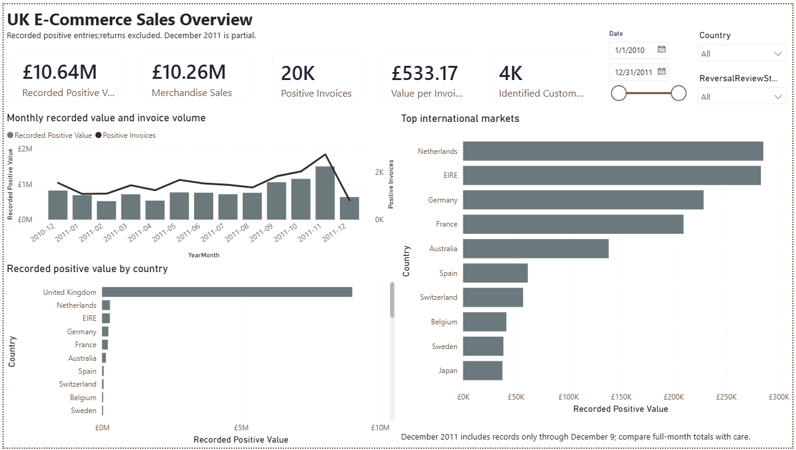
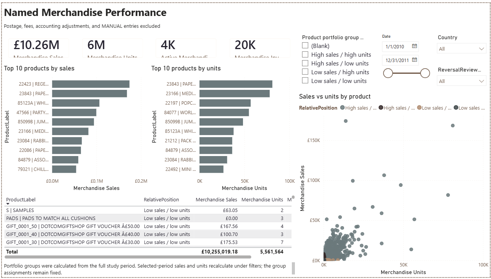
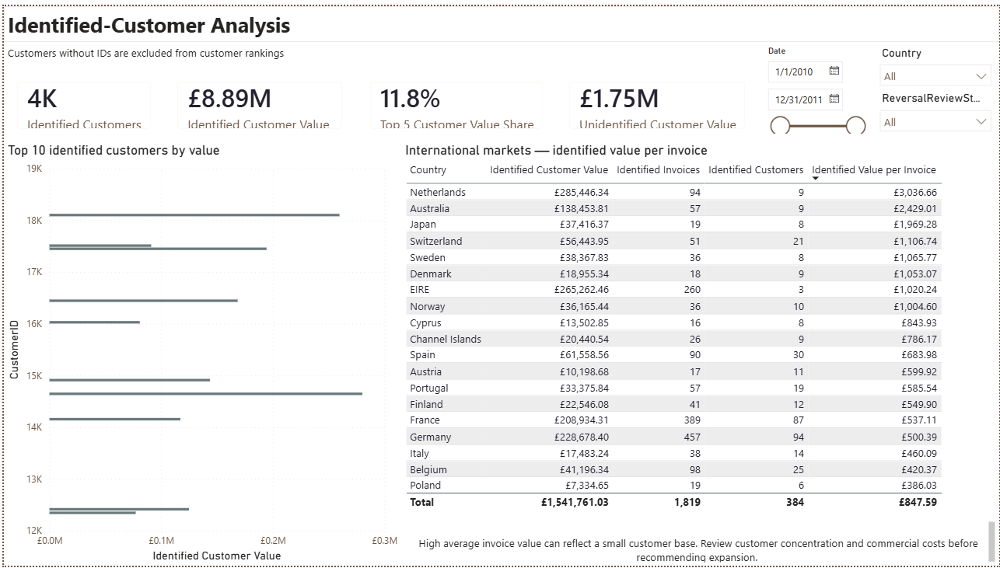
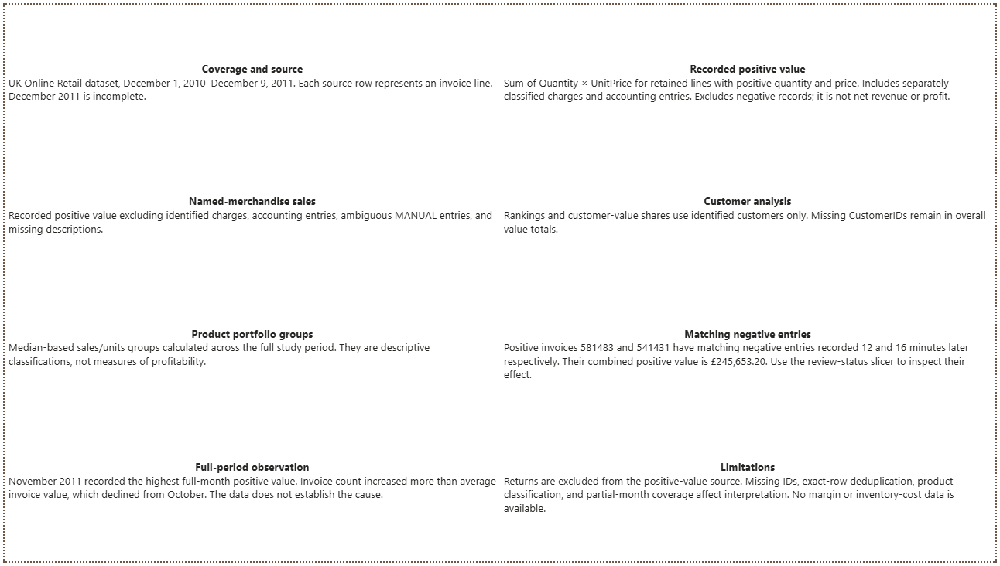
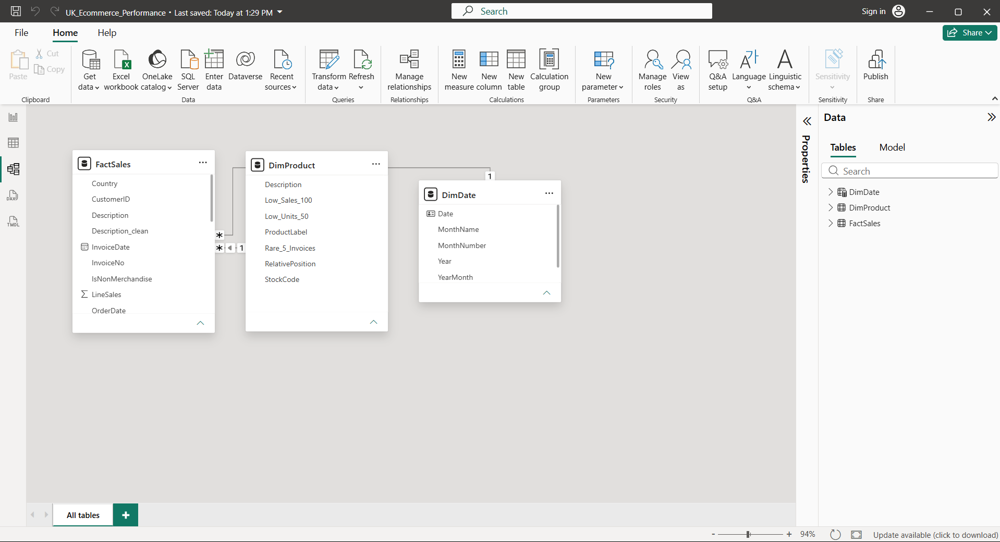

# E-Commerce Sales Analytics UK

**Python analysis and interactive Power BI reporting of UK Online Retail data**

**Author:** Tomisin Obijole  
**Tools:** Python, Pandas, NumPy, Matplotlib, Seaborn, Power Query, Power BI, DAX

## Overview

This project examines sales activity, merchandise performance, customer
concentration, geographic differences, and unusual invoice lines in the
UK Online Retail dataset.

The workflow combines documented data preparation in Python with a
four-page interactive Power BI report. Particular attention is given to
metric definitions, missing customer identifiers, inconsistent product
codes, non-merchandise entries, and exceptionally large transactions.

**Observed period:** 1 December 2010–9 December 2011.

## Report Preview



## Business Questions

1. What recorded positive value and merchandise sales appear in the data?
2. Which merchandise products generate the highest sales and unit volumes?
3. Which products appear infrequently or record low sales or units?
4. Which identified customers contribute the most value?
5. How do sales and invoice activity change over time?
6. Which countries generate the highest recorded value?
7. How concentrated is value among identified customers?
8. Which unusual entries require investigation before drawing conclusions?

## Key Results

Results below refer to the full observed period with country, product,
and review-status filters cleared.

| Metric | Result |
|---|---:|
| Original invoice-line records | 541,909 |
| Retained positive-value invoice lines | 524,878 |
| Recorded positive value | £10,642,110.80 |
| Named-merchandise sales | £10,255,019.18 |
| Named-merchandise units | 5,561,564 |
| Distinct positive-value invoices | 19,960 |
| Recorded value per invoice | £533.17 |
| Identified customers | 4,338 |
| Identified-customer positive value | £8,887,208.89 |
| Top-five share of identified-customer value | 11.8% |

### Observed Insights

- November 2011 recorded the highest full-month positive value:
  £1,503,866.78, up 30.6% from October. Invoice count increased from
  2,040 to 2,769, while value per invoice decreased from £564.34 to
  £543.11. The increase coincided with more invoices rather than larger
  average invoice values.

- The United Kingdom dominated recorded positive value. The Netherlands
  and EIRE were the largest international markets by recorded value.

- Within the identified-customer international comparison restricted to
  countries with at least ten invoices, the Netherlands recorded the
  highest value per invoice: £3,036.66 across 94 invoices and nine customers.

- REGENCY CAKESTAND 3 TIER led named-merchandise sales. PAPER CRAFT,
  LITTLE BIRDIE led positive unit volume, but its result was driven by
  one exceptionally large invoice line with a matching negative entry.

- The top five identified customers contributed 11.8% of
  identified-customer positive value. Customer conclusions exclude
  records without CustomerID.

- Two exceptionally large positive lines totalled £245,653.20.
  Matching negative entries were recorded 12 and 16 minutes later.
  These records materially affect product and customer rankings.

## Metric Definitions

**Recorded positive value** is the sum of Quantity × UnitPrice for retained
lines with positive quantity and unit price. It includes separately
classified charges and accounting entries.

**Named-merchandise sales** apply additional exclusions for identified
postage, fees, accounting adjustments, ambiguous MANUAL entries, and
missing descriptions.

**Neither measure represents net revenue after returns or profit.**

Customer-level measures include only records with a CustomerID.
Distinct InvoiceNo values are used as an order proxy; individual rows
are invoice lines.

## Data Preparation

The notebook documents:

- Original schema, missingness, duplicate records, and unusual values.
- Removal of 5,268 exact duplicate copies under an explicit analytical
  deduplication assumption.
- Date conversion and validation.
- Selection of positive-quantity, positive-price invoice lines.
- Retention of missing CustomerIDs for aggregate analysis.
- Text and product-code standardisation.
- Uppercase stock-code normalisation before product aggregation to
  consolidate case variants such as `35809A` and `35809a`.
- Classification of non-merchandise entries.
- Feature engineering for invoice-line value and time analysis.
- Export of consistent analytical tables for Power BI.

## Power BI Report

| Page | Purpose |
|---|---|
| Sales Overview | Headline measures, monthly patterns, and geography |
| Product Performance | Merchandise rankings, units, and portfolio groups |
| Customer Analysis | Identified-customer value and international invoice averages |
| Definitions & Data Quality | Scope, assumptions, exclusions, and investigated records |

The model uses an invoice-line fact table and date/product dimensions,
with active one-to-many relationships and single-direction filtering.

The report includes 15 documented DAX measures and filters for date,
country, product portfolio group, and review status.

Product portfolio groups were calculated across the full study period.
Their assignments remain fixed when the report's date filter changes;
the associated sales and unit measures recalculate.

### Review-Status Filter

Positive invoices `581483` and `541431` have matching negative entries
in the source data.

The default view includes their positive lines to match the documented
positive-value definition. Selecting **Other positive lines** excludes
these two investigated invoices.

This is a sensitivity comparison, not a net-sales calculation.

## Project Files

- [Analysis notebook](notebooks/E-Commerce_Sales_Analytics_UK.ipynb)
- [Power BI report](report/E-commerce_Performance.pbix)
- [PDF insights report](docs/E-commerce_Report.pdf)
- [DAX measures and definitions](docs/dax_measures.md)
- [Data preparation instructions](data/README.md)
- [Demonstration guide](demo/README.md)

### Additional Previews









## Run the Analysis

Python 3.10 or later is recommended.

```bash
python -m venv .venv
```

Activate the environment on Windows:

```powershell
.venv\Scripts\Activate.ps1
```

Or on macOS/Linux:

```bash
source .venv/bin/activate
```

Install dependencies and open JupyterLab:

```bash
python -m pip install -r requirements.txt
python -m jupyterlab
```

Download the source CSV using the instructions in `data/README.md`.
Open `notebooks/E-Commerce_Sales_Analytics_UK.ipynb` and run all cells
from top to bottom.

## Open and Refresh Power BI

Download `report/E-commerce_Performance.pbix` and open it in
Power BI Desktop.

To refresh:

1. Run the notebook to regenerate the processed CSVs.
2. Open Power Query through Transform data.
3. Update the source locations for `positive_sales.csv` and
   `product_summary.csv`.
4. Confirm InvoiceNo and StockCode remain Text.
5. Refresh the report and reconcile the baseline measures.
6. Restore default filters before saving.

GitHub provides the PBIX for download; it does not display it as a
live interactive Power BI report.

## Limitations

- Exact-row deduplication is an analytical assumption because no separate
  invoice-line identifier is provided.
- Returns and negative adjustments are excluded from positive-value measures.
- Missing CustomerIDs limit customer-level conclusions.
- Charges and accounting entries require classification judgment.
- Some retained entries, including vouchers or samples, require further
  classification before physical-inventory decisions.
- December 2011 contains records only through December 9.
- The coverage does not establish repeatable multi-year seasonality.
- Recorded sales value does not establish profitability.
- Matching negative entries provide strong reversal evidence, but the
  source does not supply an explicit invoice-linkage field.

## Source and Attribution

Dataset: [UK Online Retail on Kaggle](https://www.kaggle.com/datasets/carrie1/ecommerce-data).

The dataset belongs to its original source and contributors. Verify the
source licence before redistributing raw or processed data.

## Author
(screenshots/personal/Tomisin.jpg)
**Tomisin Obijole**

- [GitHub](https://github.com/Tomisin510)
- [LinkedIn](https://www.linkedin.com/in/tomisin-obijole/)